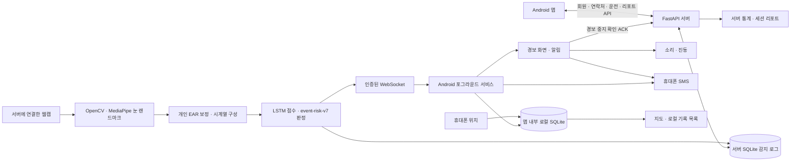

**NSND 전체 기능·구현 상태 분석 — 2026-10-16**

> 이 문서는 코드 수정 전 분석이다. 이후 구현·수정된 GPS 동기화, 거리 저장, SMS 이력 및 최신 검사 결과는 [소프트웨어 구현 결과](NSND_소프트웨어_구현결과_2026-10-16.md)를 참고한다.

현재 NSND는 **Android 앱과 FastAPI 서버를 연결한 졸음 감지 시스템**이다. 회원·연락처·운전 세션·서버 카메라 감지·3단계 경보·휴대폰 SMS·로컬 GPS 기록·지도·리포트의 주요 코드가 연결되어 있다. 반면 CO₂는 고정 표시값이고 마사지기는 화면 조작만 구현되어 있으며, 아두이노·창문·LED 등 작품 구성도의 하드웨어 제어 코드는 없다. 핵심 소프트웨어는 상당 부분 구현됐지만, 실기기 안전 기능 검증과 몇 가지 명확한 결함 수정이 남아 있다.

이 보고서에서 ‘구현’은 실제 코드와 호출 경로가 존재한다는 뜻이다. ‘검증’은 이번에 실행한 검사로 확인한 범위만 뜻한다. 코드가 존재한다는 사실을 실제 운전 환경에서의 성능 보장으로 해석하지 않았다.

**1. 검토 범위와 기준**

| 구분 | Android 앱 | 백엔드·모델 학습 |
|---|---|---|
| 경로 | `C:\Users\home\AndroidStudioProjects\NSND` | `C:\Users\home\Documents\NSND` |
| 분석 시작 시 Git 커밋 | `57bbbc1` | `b338672` |
| 프로젝트 파일 | 227개 | 57개 |
| 텍스트 줄 수 | 14,174줄 | 9,195줄 |
| 주요 소스 | Kotlin 64개: 본체 51, JVM 테스트 6, 계측 테스트 7 | Python 35개: 서버·학습·진단·테스트 |
| 추가 파일 | XML 119개, HTML, JS 테스트, 이미지, Gradle 설정 등 | DB 2개, 모델 2개, 스케일러 2개, 랜드마크 모델, CSV 등 |

집계 시점의 전체 파일은 34,112개였다. 그중 `.git` 1,041개, `.gradle` 16개, `build` 1,931개, `.venv` 30,824개, `__pycache__` 16개는 프로젝트 자체 구현과 분리했다. **프로젝트 파일 284개를 대상으로 소스·설정·문서 전문을 검토하고, 이미지·모델·DB는 형식에 맞춰 확인했다.** 텍스트 23,369줄에는 기존 학습 CSV 3,405줄이 포함된다.

가상환경의 외부 라이브러리 30,824개와 Git 객체를 모두 소스 수준으로 정독했다고 주장하지 않는다. 이들은 전체 경로·크기 목록을 수집했고, 프로젝트가 직접 작성한 코드와 의존성 선언을 중심으로 분석했다. 모델은 구조·메타데이터·체크섬·실제 로드를 확인했고, DB는 읽기 전용으로 스키마와 집계값을 조사했다. 개인 이름·전화번호·비밀번호 해시·토큰은 보고서에 옮기지 않았다. 실기기의 앱 내부 DB는 이번 조사 대상 폴더에 없으므로 내용 자체는 조회하지 않았다.

문서·주석·디자인 이미지와 현재 코드가 충돌하면 **실행 코드 → 이번 검증 결과 → 문서의 과거 기록** 순서로 판단했다. 분석 중 애플리케이션 소스는 수정하지 않았다.

- [284개 파일별 검토 목록](C:/Users/home/Documents/NSND/NSND_파일별_검토목록_2026-10-16.md)
- [전체 파일 인벤토리·SHA256·XML 구조·DB 집계](C:/Users/home/.codex/visualizations/2026/10/16/01a1432f-f1e2-7d31-a719-f1720fa543e2/NSND_file_inventory.json)
- [모델 로드와 판정 재현 결과](C:/Users/home/.codex/visualizations/2026/10/16/01a1432f-f1e2-7d31-a719-f1720fa543e2/runtime_audit_results.json)

**2. 현재 시스템의 실제 구조**

중요한 경계는 다음과 같다.

- **카메라는 서버 측 웹캠이다.** 휴대폰 카메라 영상을 서버로 전송하는 기능은 없다.
- **AI 추론도 서버에서 한다.** Android 앱 안에서 TensorFlow 모델을 실행하지 않는다.
- **SMS는 휴대폰에서 발송한다.** 서버의 Aligo/SMS 서비스 코드는 현재 없다.
- **GPS는 휴대폰에서 수집하여 앱 내부에 저장한다.** 현재 서버 감지 로그에 좌표를 보내는 API 연결은 없다.
- 서버 한 프로세스에서 동시에 동작하는 감지 세션은 하나다. 여러 사용자에게 카메라를 나누어 주는 구조가 아니다.
- 앱의 ‘운전 세션’과 ‘카메라 감지 실행’은 분리된다. 운전 중 감지만 일시정지할 수 있다.

기술 구성은 Kotlin/XML/ViewBinding/Navigation/ViewModel·LiveData/Coroutine, Retrofit·OkHttp, Android SQLite, Fused Location, Kakao 지도, MPAndroidChart다. Android 최소 API 26, 대상·컴파일 API 36, AGP 8.13.2, Kotlin 2.0.21, Gradle 8.13이다. 서버는 FastAPI·SQLAlchemy 비동기 ORM·SQLite·JWT·bcrypt와 OpenCV·MediaPipe·TensorFlow를 사용한다. 현재 가상환경은 Python 3.13 기반이다. 일부 AI 의존성은 버전이 고정되지 않았다.

**3. 화면과 기능별 구현 상태**

| 영역 | 현재 실제 기능 | 판정 |
|---|---|---|
| 회원가입·로그인 | 서버 저장, 암호 해시, JWT, 저장된 로그인 검증 | 구현됨 |
| 중복 로그인 관리 | 사용자별 유효 로그인 세션 1개, 기존 토큰 취소, 감지 중 타 기기 로그인 차단 | 구현됨 |
| 로그아웃·회원탈퇴 | 서버 토큰 취소, 탈퇴 시 관련 DB 자료와 현재 계정 로컬 자료 삭제 | 구현됨 |
| 홈 운전 제어 | 운전 시작/종료, 감지 시작/일시정지, 재접속 상태 복원 | 구현됨 |
| 서버 상태 표시 | 서버 접근·모델 준비·카메라 상태·현재 감지 상태 표시 | 구현됨 |
| 졸음 감지 | 개인 EAR 보정, 배포 LSTM, 사건·반복 기반 v7 판정 | 구현·모델 로드 확인 |
| 경보 | 모든 탭에서 화면 연결, 반복 소리·진동·시각 효과, 수동 중지·ACK | 구현됨; 기기별 검증 남음 |
| 비상 연락처 | 서버 CRUD, 계정별 캐시, 기본 메시지 선택 | 구현됨 |
| SMS | 수동 테스트 발송, 3단계 자동 발송 코드 | 부분 완료: 전달 확인·실패 복구 없음 |
| GPS 기록 | 수신 시점 위치 품질 검사, 로컬 이벤트 저장, 거리 누적 | 구현됨; 서버 전달·거리 영속화 없음 |
| 지도 | 로컬/서버 출처 선택, 날짜/전체, 마커·현재 위치·목록 | 구현됨; 실제 Kakao 인증은 별도 확인 필요 |
| 수면 데이터 | 날짜별 통계·차트, 세션 이력·상세, 지도 연결 | 구현됨; 감지 로그 기반 지표 |
| CO₂ | 1,240 ppm 및 09:41 표시, 표시값에 따른 상태 문구 | 화면 시연만 구현 |
| 마사지기 | 1~5단계 UI, 기본 3단계, 저장 완료 모양 변경 | 화면 시연만 구현 |
| 테마·사이드바 | 시스템/라이트/다크, 사용자 정보, 서버 주소, 계정 관리 | 구현됨 |
| Arduino·창문·LED 제어 | 그림과 계획에만 존재 | 미구현 |
| iOS·Flutter 앱 | 현재 코드 없음 | 미구현/과거 계획 |

**4. 회원·인증·계정별 데이터 보호**

가입 화면은 이름·아이디·비밀번호·비밀번호 확인을 받고 서버에 계정을 만든다. 서버는 중복 아이디를 거부하고 bcrypt로 비밀번호를 저장한다. 로그인은 아이디·비밀번호와 기기 식별값을 사용한다. 응답은 Bearer JWT다.

JWT에는 사용자 식별자 외에 로그인 세션 식별자 `sid`가 들어간다. 서버는 `login_sessions`와 대조하여 토큰이 현재 유효한 로그인인지 확인한다. 새 로그인은 이전 토큰을 무효화한다. 감지 중인 사용자가 다른 기기로 로그인하면 충돌을 반환한다. 동일 기기 재로그인은 허용하여 연결 복구에 대응한다.

앱은 시작할 때 저장 토큰으로 `/auth/me`를 확인한다. 메인 화면이 활성 상태일 때도 약 15초 주기로 인증을 확인한다. 단순 통신 장애와 인증 만료를 구분하고, 401이면 로그인으로 돌아간다. WebSocket도 연결 시와 이후 약 1초 간격으로 인증 상태를 재확인한다. 토큰을 URL 쿼리에 넣는 방식은 사용하지 않는다.

로컬 연락처·감지 기록은 서버가 JWT에 넣은 불투명한 `account_key`로 나눈다. 이 값은 사용자 ID와 비밀번호 해시를 서버 비밀키로 HMAC 처리한 계정 식별자다. 같은 계정 재로그인은 기록을 유지하고, 탈퇴 후 같은 숫자 ID를 재사용해도 이전 계정 기록을 읽지 못하도록 설계되어 있다. 기존 식별정보가 부족한 로컬 캐시는 무조건 현재 사용자에게 합치지 않는다.

주의할 세부점은 현재 새 계정 키가 **서버 URL 문자열을 직접 포함하는 구조는 아니라는 점**이다. 같은 서버를 다른 주소로 접속해도 동일 계정 키면 같은 로컬 기록을 볼 수 있다. 독립 서버 구분은 서버 비밀키와 계정 해시의 차이에 의존한다. DB와 비밀키를 그대로 복제한 서버까지 자동으로 별도 계정 영역이 되는 것은 아니다.

로그아웃은 토큰을 취소하되 계정 캐시는 유지한다. 탈퇴는 서버 사용자·로그인 세션·연락처·운전 세션·감지 로그를 삭제하고 현재 계정의 로컬 연락처·감지 기록도 정리한다. 탈퇴 직후 서비스의 대기 중 저장 작업이 데이터를 다시 만들지 않도록 계정 폐기 처리도 있다. 자동 백업·기기 이전에서 인증 설정과 로컬 감지 DB 및 WAL/SHM을 제외한다.

남은 부분은 비밀번호 찾기·변경, 강한 서버측 가입 규칙, 로그인 시도 제한, 토큰 갱신 절차, 암호화된 토큰 보관, HTTPS/WSS 배포다. 현재 설정의 기본 통신은 HTTP/WS이며 개발용 비밀키 기본값도 존재한다. `.env` 파일은 조사 폴더에 없었다. 실제 실행 프로세스에 환경변수로 별도 값이 설정됐는지는 이번 분석에서 확인하지 않았다. 설정 기본 토큰 만료는 24시간인데 `.env.example`에는 1년 값이 있어 운영 기준 정리가 필요하다.

근거: [서버 인증](C:/Users/home/Documents/NSND/backend/app/routers/auth.py), [JWT 구현](C:/Users/home/Documents/NSND/backend/app/auth.py), [인증 의존성](C:/Users/home/Documents/NSND/backend/app/dependencies.py), [앱 SessionManager](C:/Users/home/AndroidStudioProjects/NSND/app/src/main/java/com/jsm/nsnd/data/session/SessionManager.kt).

**5. 홈 화면·운전 세션·서버 연결**

홈의 상태는 `IDLE → SESSION_ACTIVE → DETECTING`으로 구분된다. 운전 시작은 서버에 운전 세션을 생성한다. 감지 시작은 그 세션 ID로 카메라 감지를 요청하고 포그라운드 서비스를 연결한다. 감지 일시정지는 카메라를 해제하지만 운전 세션은 남긴다. 운전 종료는 서버 감지를 정리하고 세션 종료 시각을 기록한 다음 앱 상태를 정리한다.

앱은 서버 응답을 받기 전에 성공한 것처럼 세션을 끝내지 않도록 처리한다. 화면 복귀·상태 새로고침 시 현재 운전 세션과 감지 상태를 조회해 복원하며, 오래된 요청 응답이 다른 계정·세션의 화면을 덮지 않도록 검사가 있다. 중지 API의 404도 실제 서버 상태가 이미 비활성인지 확인해 처리한다.

표시되는 정보는 세션 번호, 운전 시간, GPS 거리, 현재 졸음 단계, EAR, 감지·보정·얼굴 미검출 상태, 최근 이벤트 최대 10개, 서버 준비 상태다. 운전 시간은 서버 시작 시각을 기준으로 계산한다. 거리는 휴대폰 위치 차이를 누적하지만 현재 메모리 상태이므로 앱 프로세스가 다시 시작되면 이어서 복원할 수 없다. 서버 DB에도 거리 컬럼이 없다.

서버 주소는 로그인 화면과 사이드바에서 변경할 수 있다. 기본 주소는 Android 에뮬레이터용 `10.0.2.2:8000`이며 호스트 입력 검사가 있다. 현재 UI는 호스트 중심이고 포트는 8000, 프로토콜은 HTTP/WS로 고정된다. 세션 진행 중 변경을 막고 변경 시 기존 인증을 정리한다. 실제 휴대폰에서는 접근 가능한 서버 주소가 필요하다.

`/health`는 단순 문자열 응답이 아니다. 모델 준비 여부와 카메라 사용 가능 여부, 감지 실행 여부, 적용 모델·판정 버전을 반환한다. 비활성 상태의 카메라 가능 여부 확인에는 카메라를 잠깐 열고 닫는 동작이 포함된다. 이번 조사에서는 실제 카메라를 열어 이 API를 시험하지 않았다.

근거: [HomeFragment](C:/Users/home/AndroidStudioProjects/NSND/app/src/main/java/com/jsm/nsnd/ui/home/HomeFragment.kt), [운전 API](C:/Users/home/Documents/NSND/backend/app/routers/sessions.py), [서버 주소 설정](C:/Users/home/AndroidStudioProjects/NSND/app/src/main/java/com/jsm/nsnd/data/session/ServerConfig.kt).

**6. 현재 AI 감지의 정확한 동작**

현재 기본 배포 묶음은 `released/personal-ear-v1`이며 원본 실험 후보는 `20261013_195253_465521`이다. 현재 판정 코드 버전은 **`event-risk-v7`**이다. 모델 구조는 입력 `(30, 1)` → LSTM 16 → Dense 8/ReLU → Dropout 0.15 → Dense 1/Sigmoid다. 스케일러는 특징 1개의 StandardScaler다. 이전 원본 모델은 별도 파일로 남아 있으며 현재 기본 모델이 아니다.

처리 순서는 다음과 같다.

1. 서버에 연결된 카메라를 열고 OpenCV로 프레임을 읽는다.
2. MediaPipe FaceLandmarker로 얼굴 하나의 눈 랜드마크를 추출한다.
3. 각 눈의 세로 거리 두 개의 합을 가로 거리의 두 배로 나눠 EAR를 계산한다.
4. 초기 최소 3초 및 유효 관측 15개 이상을 모아 각 눈의 70번째 백분위 EAR를 개인 기준으로 삼는다.
5. 좌·우 EAR를 각자의 기준으로 나눈 값의 평균을 모델 입력으로 사용한다.
6. 약 0.967초 구간을 30개 표본으로 재구성한다. 고정 프레임 개수만 세는 대신 실제 시간축을 사용한다.
7. 스케일러를 적용하고 LSTM 점수를 얻는다. 모델 분류 임계값은 0.02다.
8. 점수, 양쪽 눈의 상대 EAR, 지속 시간, 사건 반복, 경보 중지 확인을 함께 사용해 0~3단계를 정한다.

`pred_score`는 모델 출력값이다. 임계값 0.02를 ‘졸 확률 2%’로 해석하거나 점수가 높다는 이유만으로 3단계가 된다고 설명하면 부정확하다. 현재 심각도는 지속·반복 규칙이 정한다.

| 조건 | 현재 값·의미 |
|---|---|
| 양쪽 눈 닫힘 | 양쪽 EAR가 각각 개인 기준의 72% 이하 |
| 모델 보조 조건 | 점수 ≥ 0.02이면서 양쪽 EAR가 각각 기준의 80% 이하 |
| 새 졸음 사건 진입 | 눈 닫힘 또는 모델 보조 상태가 1.25초 지속 |
| 독립 사건을 다시 셀 조건 | 양쪽 눈이 기준의 82% 이상으로 0.5초 유지 |
| 1단계 | 첫 유효 졸음 사건 |
| 2단계 | 최근 30초에 독립 사건 2회 |
| 3단계 | 2단계 이후 새 독립 사건 또는 양쪽 눈 연속 감김 3초 |
| 1단계 회복 | 정상 눈 상태 10초 관측 후 0단계 |
| 2·3단계 회복 | 사용자의 경보 중지 ACK 이후 정상 눈 상태 10초 관측 후 바로 0단계 |
| 짧은 깜빡임 허용 | 회복 중 0.5초 미만의 깜빡임은 복귀 시 회복 시간에 포함 |
| 회복 방해 | 긴 눈 감김·얼굴 소실·긴 관측 공백은 회복 시간 누적을 끊음 |
| 관측 공백 | 0.5초 초과 공백은 감김·회복 증거를 연속으로 취급하지 않음 |
| EAR 경계 흔들림 | 감김 중 경계 상태가 0.15초 이상이면 연속 감김을 끊음 |

얼굴이 사라지면 정상으로 간주하지 않는다. 모델 시계열과 일시적인 판정 증거는 끊지만 이미 올라간 위험 단계·사건 이력은 유지한다. 재보정은 감지 재시작 또는 독립 진단 도구의 초기화로 수행하며, 앱에는 별도 재보정 API가 없다.

WebSocket은 `CALIBRATING`, `WARMING_UP`, `DROWSY_PENDING`, `AWAKE`, `DROWSY`, `NO_FACE`, `INVALID_EAR`, `ERROR` 등을 구분한다. 추가로 관측 유효성, 모델 입력 준비, 눈 감김 시간, 회복 시간, 새 사건, ACK 필요 여부, 개인 기준 EAR, 추론 시간 등을 보낸다. 화면에서 ‘감지 안 됨’을 0단계 정상으로 오인하지 않도록 하는 데이터가 이미 있다.

현재 코드의 중요한 불일치도 확인했다. 통합 문서는 0단계 회복 시 사건 이력을 비운다고 설명한다. 실제 코드는 2·3단계 회복에서는 비우지만 **1단계 회복에서는 이력을 남긴다.** 합성 관측으로 `1.3초 감김 → 10.05초 정상 → 1.3초 감김`을 재현하니 `1단계 → 0단계(사건 수 1 유지) → 2단계`였다. 최근 30초 반복 위험을 의도한 것인지, 문서대로 초기화해야 하는지 정책을 정하고 코드·문서·테스트를 일치시켜야 한다.

근거: [v7 판정 엔진](C:/Users/home/Documents/NSND/backend/app/detection_service.py:372), [회복 분기](C:/Users/home/Documents/NSND/backend/app/detection_service.py:515), [시계열 버퍼](C:/Users/home/Documents/NSND/backend/app/ear_sequence.py), [배포 메타데이터](C:/Users/home/Documents/NSND/backend/ai_models/released/personal-ear-v1/metadata.json).

**7. 경보 화면·백그라운드 서비스·SMS**

앱의 포그라운드 서비스가 WebSocket을 유지하므로 홈 탭을 벗어나도 수신·기록을 계속할 수 있다. 서비스는 저장된 세션·계정으로 재연결을 시도하고, 일반 통신 끊김은 2초씩 늘어나는 지연으로 최대 30초 간격까지 재시도한다. 카메라 오류 같은 종료 사유는 무한 재연결하지 않고 재시작이 필요한 상태로 처리한다.

메인 화면에서는 현재 탭과 상관없이 경보 화면으로 연결하며, 이전 운전 세션의 늦은 메시지는 무시한다. 백그라운드에서는 높은 중요도의 알림과 전체 화면 인텐트로 경보를 연결한다. 경보 화면은 소리 반복 재생, 단계별 진동, 위험 색상, 링 회전, 2·3단계 점멸을 사용하며 시스템의 동작 축소 설정도 고려한다.

경보는 같은 단계 메시지가 올 때마다 새로 시작하지 않는다. 단계 상승, 사용자가 중지한 뒤 발생한 새로운 위험 등을 구분한다. 단계가 0으로 내려가거나 얼굴이 잠깐 안 보인다는 이유만으로 경보음을 자동 중지하지 않는 정책이다. 사용자가 중지를 눌러야 소리가 멈춘다.

2·3단계에서 중지 버튼을 누르면 앱은 소리·진동을 즉시 끄고 서버에 `/detection/alarm/acknowledge`를 전송한다. ACK는 서버 위험도를 즉시 0으로 만드는 요청이 아니다. 서버가 정상 눈 상태 10초 회복을 셀 수 있도록 사용자 중지를 알린다. 실패하면 소리는 끈 채 재시도 UI를 제공하며, 중복 ACK가 회복 타이머를 계속 초기화하지 않는다. ACK 처리 도중 새 위험이 들어오는 경우에도 재경보를 고려한다.

**SMS는 실제 발송 API가 연결되어 있다.** 연락처 화면의 테스트 발송과 3단계 자동 발송이 `SmsManager.sendTextMessage`를 호출한다. 자동 발송은 전경 경보 화면과 백그라운드 서비스 경로 모두 존재한다. 연락처 캐시를 이용하므로 이미 동기화한 대상은 서버가 잠깐 끊겨도 사용할 수 있다. 홈의 ‘경보 테스트’는 1단계 경보이며 SMS를 보내는 테스트와 다르다.

다만 SMS 완성도에는 다음 한계가 있다.

- 전송·수신 결과 PendingIntent가 없어 통신망 발송 성공이나 상대방 수신을 확인하지 않는다. 화면의 ‘발송했습니다’는 API 호출 완료에 가깝다.
- 백그라운드의 권한 누락·예외는 발송 누락으로 끝날 수 있으며, 재전송 대기열·영속 발송 이력·전달 상태 화면이 없다.
- 메시지에 GPS 위치나 지도 링크를 자동 첨부하지 않는다. 등록된 문구 그대로 보낸다.
- 발송 처리를 했다는 메모리 상태와 실제 성공 여부가 분리되어 있지 않다. 같은 경보 Activity가 유지되는 동안의 새 3단계 사건에는 SMS가 다시 나가지 않는 경우도 있다.
- 연락처가 없거나 SMS 권한이 없어도 감지 자체를 시작할 수 있다.
- 실제 SIM·통신사·다중 SIM·잠금 화면·알림 차단·절전 상태의 동작은 이번 검사로 검증되지 않았다.

전체 화면 권한 확인 함수는 현재 바로 다음 시작 단계로 넘어간다. 권한 확인/설정 안내용 함수는 있지만 실제 분기에 연결되지 않았다. 또한 반복 오디오의 소유자는 경보 Activity이므로 해당 화면이 생성되지 않거나 종료되는 기기 상황까지 지속 경보를 보장한다고 단정할 수 없다.

근거: [감지 서비스](C:/Users/home/AndroidStudioProjects/NSND/app/src/main/java/com/jsm/nsnd/service/DetectionForegroundService.kt), [경보 정책](C:/Users/home/AndroidStudioProjects/NSND/app/src/main/java/com/jsm/nsnd/data/local/DrowsinessAlarmPolicy.kt), [경보 화면](C:/Users/home/AndroidStudioProjects/NSND/app/src/main/java/com/jsm/nsnd/ui/overlay/AlertOverlayActivity.kt), [권한 처리](C:/Users/home/AndroidStudioProjects/NSND/app/src/main/java/com/jsm/nsnd/ui/auth/LoginActivity.kt:140).

**8. 비상 연락처 관리**

연락처는 이름·전화번호·자동 발송 메시지를 가진다. 앱에서 추가·수정·삭제하면 실제 `/contacts` API로 서버에 반영한다. 서버가 실패하면 성공한 것처럼 캐시를 바꾸지 않고 마지막 동기화 자료를 유지한다. 앱과 서버 모두 공백 이름·문구 등을 검사하고, 전화번호 정리 및 중복 번호 방지를 수행한다. 앱은 8~15자리 전화번호를 허용하며 메시지 UI는 미리 정의한 4개 문구를 선택하는 방식이다.

계정별 연락처 캐시와 오래된 로컬 연락처의 서버 이전 경로도 있다. 이전 실패 항목을 성공한 서버 연락처로 위장하지 않는다. 화면 재진입 시 서버와 재동기화한다.

미완성 또는 불일치는 마지막 연락처 삭제 정책이다. 앱은 마지막 한 개 삭제를 막지만 서버는 삭제를 허용한다. 처음부터 연락처가 없는 상태도 가능하다. 따라서 ‘항상 최소 한 명에게 비상 문자가 전송된다’는 보장은 없다. API는 임의 메시지를 저장할 수 있지만 앱에는 자유 입력 UI가 없다. `/auth/contacts`의 옛 단일 `emergency_contact` 필드와 새 다중 연락처 테이블은 별개이며 현재 앱의 주 경로는 `/contacts`다.

근거: [연락처 화면](C:/Users/home/AndroidStudioProjects/NSND/app/src/main/java/com/jsm/nsnd/ui/contact/ContactFragment.kt), [연락처 캐시](C:/Users/home/AndroidStudioProjects/NSND/app/src/main/java/com/jsm/nsnd/ui/contact/ContactLocalStore.kt), [연락처 API](C:/Users/home/Documents/NSND/backend/app/routers/contacts.py).

**9. GPS·로컬 감지 기록·주행 거리**

휴대폰 위치는 Fused Location Provider로 수집한다. 기본 요청 간격은 약 3초, 최소 간격은 1.5초다. 운전·감지·지도 사용 상태를 고려하여 위치 추적을 공유한다. 이벤트 위치와 주행 거리에는 서로 다른 품질 기준을 적용한다.

| 항목 | 이벤트 위치 기록 | 거리 누적 |
|---|---|---|
| 시간 기준 | 앱이 감지 결과를 수신한 시각 | 두 위치 표본 간 시간 |
| 오래된 위치 제한 | 약 30초 이내 | 두 표본 간 1ms~30초 |
| 정확도 제한 | 100m 이하 | 양쪽 표본 모두 40m 이하 |
| 추가 조건 | 유한한 위·경도, 정상 좌표 범위 | 이동 0.5m 초과, 계산 속도 100m/s 이하 |
| 저장 | 앱 내부 SQLite에 영속 저장 | 메모리 누적, 서버 미저장 |

로컬 이벤트에는 UUID, 계정 키, 사용자·운전 세션 ID, 수신 시각, 단계, EAR, 예측 점수, 좌표, 위치 측정 시각·정확도·실패 사유가 저장된다. 좌표가 없더라도 사건 자체를 버리지 않는다. 권한 거부, 위치 서비스 꺼짐, 위치 미수신, 오래된 위치, 정확도 부족을 구분한다. 나중에 얻은 좌표로 과거 사건 위치를 임의 보충하지 않는다.

저장 대상은 유효한 감지 관측에서 발생한 양수 단계 변화다. 같은 단계가 반복 수신된다고 매 프레임 저장하지 않는다. 0단계는 단계 변경 체크포인트만 남겨 다음 사건을 다시 기록할 수 있게 한다. 기록 삽입과 체크포인트 변경을 같은 트랜잭션으로 묶었고 앱 재실행 후에도 체크포인트를 유지한다. 핑·오류·잘못된 JSON·유효하지 않은 관측은 정상 사건으로 저장하지 않는다.

서버 결과에는 사건의 영속 ID와 감지 원시 시각이 제공되지 않는다. 따라서 휴대폰 기록 시각은 **서버 촬영 시각이 아니라 앱 수신 시각**이다. 네트워크 지연 중 차량이 이동하면 실제 촬영 지점과 기록 위치가 어긋날 수 있다. 네트워크 단절 구간의 사건을 서버에서 찾아 로컬로 복구하는 기능도 없다.

근거: [LocationTracker](C:/Users/home/AndroidStudioProjects/NSND/app/src/main/java/com/jsm/nsnd/service/LocationTracker.kt), [기록 정책](C:/Users/home/AndroidStudioProjects/NSND/app/src/main/java/com/jsm/nsnd/data/local/DetectionPolicy.kt), [로컬 DB](C:/Users/home/AndroidStudioProjects/NSND/app/src/main/java/com/jsm/nsnd/data/local/LocalDetectionStore.kt).

**10. 지도 화면과 지도 연동**

지도 탭에는 전체/날짜 필터, 로컬/서버 출처 선택, 단계별 건수, 새로고침, 마커 상세, 전체 마커 범위 맞춤, 현재 위치 이동, 좌표가 없는 기록을 포함한 목록이 있다. 로컬과 서버 출처는 사용자가 선택하며 두 자료를 같은 사건이라고 추정하여 합산하지 않는다.

주 지도는 Kakao Native SDK를 사용하고 오류 시 WebView의 Kakao JavaScript 지도 대체 경로를 제공한다. 수면 데이터 화면은 WebView 지도를 사용하고 세션 상세에는 Native 지도가 있다. 세션 상세 지도에는 주 지도와 같은 WebView 대체 경로가 없다.

마커에는 단계별 색상과 시간, 위치, 출처 관련 상세 정보가 연결된다. 같은 위치 또는 매우 가까운 위치에 여러 사건이 있어도 UUID/기록 식별자를 사용해 선택할 수 있다. 현재 위치 마커와 사건 마커를 분리하여 필터 변경 시 현재 위치가 잘못 지워지지 않도록 처리한다. 현재 위치는 오래된 표본을 계속 최신처럼 표시하지 않으며, 위치 실패 시 임의 좌표를 현재 위치로 만들지 않는다. 초기 지도 중심은 기본 표시 중심일 뿐이다.

로컬 좌표는 국내 밖이라도 유효하면 보존한다. Kakao 배경 지도의 지역 범위 제약은 별도 안내한다. 지도 필터·선택 날짜 등의 화면 상태도 유지한다.

남은 사항은 다음과 같다.

- 현재 ‘주행지도’는 사건 발생 지점 지도다. 이동 경로를 연속 저장한 궤적, 경로선, 길 안내, 경로 재생은 없다.
- 실제 Kakao 앱 키의 플랫폼 등록·Android 키 해시·웹 도메인 허용 여부는 이번에 네트워크 지도로 검증하지 않았다. WebView에는 `https://localhost:5173` 기준 주소가 사용된다.
- x86/x86_64용 네이티브 라이브러리가 없는 항목에 대한 빌드 경고가 있었다. 에뮬레이터와 ARM 실기기에서 동일한 Native 지도 동작을 가정하면 안 된다.
- 서버 ‘전체’ 지도 조회는 종료된 세션 이력에서 상세를 모은다. 날짜별 서버 조회는 진행 중 세션도 포함할 수 있어, 운전 중에는 두 필터의 결과가 다를 수 있다.
- 서버 좌표 컬럼과 조회 UI는 존재하지만 휴대폰 GPS 업로드 연결이 없다. 기존 좌표 데이터는 표시할 수 있어도 새 서버 로그에는 위치가 채워지지 않는다.

근거: [MapFragment](C:/Users/home/AndroidStudioProjects/NSND/app/src/main/java/com/jsm/nsnd/ui/map/MapFragment.kt), [지도 HTML](C:/Users/home/AndroidStudioProjects/NSND/app/src/main/assets/kakao_map.html), [서버 지도 변환](C:/Users/home/AndroidStudioProjects/NSND/app/src/main/java/com/jsm/nsnd/ui/common/ServerMapRecords.kt).

**11. 수면 데이터·리포트·운전 이력의 의미**

수면 데이터 탭은 날짜별 분석과 운전 기록 히스토리로 나뉜다. 날짜를 선택하면 서버의 해당 날짜 감지 로그를 집계하여 단계별 횟수, 총 기록 수, 안전 점수, 등급, 많이 감지된 시간대, 시간대별 최고 단계 차트를 표시한다. 지도와 이벤트 목록은 로컬/서버 출처를 선택할 수 있다. 점수·통계는 서버 자료 기준이며 로컬 기록을 더하지 않는다.

안전 점수 공식은 다음과 같다.

`max(0, 100 − 2 × 1단계 로그 수 − 5 × 2단계 로그 수 − 15 × 3단계 로그 수)`

80점 이상은 `safe`, 50~79점은 `caution`, 50점 미만은 `danger`다. 가장 위험했던 시간은 가중 위험도가 아니라 **로그 수가 가장 많은 시간대**다. 그래프의 세로 값은 시간대별 최고 감지 단계다. 지속적인 실제 수면 단계, REM/비REM, 수면 시간 측정 기능이 아니다. 일부 UI의 ‘수면 단계’ 문구는 기능의 실제 의미보다 넓게 읽힐 수 있다.

서버는 로그가 없을 때 수학적으로 100점을 반환하지만, 앱은 이를 안전 운전의 증거로 그대로 표시하지 않고 ‘판정 자료 부족’ 및 `--` 등으로 처리한다. 올바른 방향이다. 다만 서버 DB에는 유효 관측 시간·얼굴 미검출 시간·통신 끊김 시간·감지 중지 시간이 기록되지 않는다. 따라서 ‘잘 감시했고 졸음이 없었던 주행’과 ‘카메라 감지가 거의 없었던 주행’을 지표만으로 구별하기 어렵다.

서버 로그는 **유효 관측에서 단계가 상승한 순간**에 저장한다. 같은 3단계 상태에서 새로운 졸음 사건이 더 생겨도 단계 상승이 아니면 새 로그가 저장되지 않는다. 반대로 한 번의 긴 눈 감김이 1단계를 지나 3단계로 상승하면 두 로그가 생길 수 있다. 따라서 화면의 ‘졸음 N회’는 엄밀히 말해 현재 저장 정책에 따른 감지 로그 수이며, 독립 졸음 사건 수와 항상 같지 않다.

히스토리는 서버 세션과 로컬 기록 묶음을 출처별 행으로 보여준다. 로컬에는 주행 전체 세션 메타데이터가 없으므로 사건이 있는 세션을 묶은 목록이며 서버와 같은 운전 시간·안전 점수를 계산하지 않는다. 로컬 행 선택은 해당 날짜 지도 연결이고 완전한 세션 전용 리포트와는 다르다. 서버 세션은 바텀시트 상세 리포트를 제공한다.

날짜별 API는 `utc_offset_minutes`를 받아 현지 자정 기준으로 서버 UTC 자료를 조회한다. 한국 시간 자정과 UTC 날짜 차이를 다룬 테스트도 있다. 반면 최근 세션/특정 세션 리포트의 시간대 집계는 `timestamp.hour`를 그대로 사용하므로 UTC 기준이다. 날짜별 리포트와 세션 리포트 시간대의 의미를 통일해야 한다.

근거: [SleepDataFragment](C:/Users/home/AndroidStudioProjects/NSND/app/src/main/java/com/jsm/nsnd/ui/sleepdata/SleepDataFragment.kt), [세션 상세](C:/Users/home/AndroidStudioProjects/NSND/app/src/main/java/com/jsm/nsnd/ui/sleepdata/SessionDetailBottomSheetFragment.kt), [리포트 계산](C:/Users/home/Documents/NSND/backend/app/routers/report.py:35).

**12. CO₂·마사지기·작품 구성도의 하드웨어**

CO₂ 카드는 [HomeFragment의 `setupCo2Display`](C:/Users/home/AndroidStudioProjects/NSND/app/src/main/java/com/jsm/nsnd/ui/home/HomeFragment.kt:867)에서 `dummyCo2Value = 1240`, `dummyTime = "09:41"`을 사용한다. 1,000 미만/2,000 미만/그 이상에 따른 상태 문구와 색상은 있지만 실제 센서 측정은 아니다. 측정 주기·장치 연결 상태·최근 수신 시각·서버 센서 저장·센서 통신 프로토콜이 없다.

마사지기 화면은 기본 3단계, 최소 1·최대 5단계다. +/- 버튼에 따라 숫자·원형 링·색상·진행 바·점 표시가 변한다. [저장 함수](C:/Users/home/AndroidStudioProjects/NSND/app/src/main/java/com/jsm/nsnd/ui/massager/MassagerFragment.kt:139)는 버튼을 1.5초 동안 ‘저장되었습니다’ 모양으로 바꿀 뿐이다. 서버 요청, BLE/Serial 제어, 설정의 영속 저장, 실제 장치 응답 확인은 없다. Fragment 객체가 새로 만들어지면 기본값 3에서 시작한다. 이 완료 문구는 실제 적용 여부를 오해하게 할 수 있다.

작품 구성 이미지에는 Jetson Nano, Arduino UNO, MQ135, 서보모터 창문 제어, 청색 LED 등 구성이 나온다. 그러나 두 폴더의 프로젝트 구현에는 Arduino 펌웨어, GPIO·Serial·BLE·MQTT 장치 연동, 창문/LED/마사지기 제어 API가 없다. 따라서 현재 완성된 것은 서버 웹캠 기반 소프트웨어 경로이며 작품 구성도 전체의 하드웨어 시스템은 아니다. Jetson에서 바로 재현 가능한 패키지 고정·배포 서비스 설정도 별도로 갖춰야 한다.

**13. 서버 API 전체 목록**

FastAPI 기본 문서 경로를 제외한 업무 API는 HTTP 23개와 WebSocket 1개다. 보호 API는 Bearer JWT와 소유자 검사를 사용한다.

| 방식·경로 | 역할·입력 | 현재 연결 상태 |
|---|---|---|
| GET `/health` | 모델·카메라·감지·판정 버전 확인 | 홈 상태 확인, 비인증 |
| POST `/auth/register` | 아이디·이름·비밀번호 등으로 가입 | 가입 화면 |
| POST `/auth/login` | 아이디·비밀번호·device_id, JWT 반환 | 로그인 화면 |
| GET `/auth/me` | 로그인 사용자 조회 | 시작·주기 인증 확인 |
| DELETE `/auth/logout` | 현재 로그인 세션 취소 | 로그아웃 |
| PUT `/auth/contacts` | 옛 단일 비상 연락처 변경 | 현재 다중 연락처 UI의 주 경로 아님 |
| DELETE `/auth/me` | 탈퇴·관계 데이터 삭제 | 사이드바 탈퇴 |
| GET `/contacts` | 현재 사용자의 연락처 목록 | 연락처·홈 캐시 갱신 |
| POST `/contacts` | 이름·전화번호·메시지 추가 | 연락처 추가 |
| PUT `/contacts/{contact_id}` | 연락처 수정 | 연락처 편집 |
| DELETE `/contacts/{contact_id}` | 연락처 삭제 | 연락처 삭제 |
| POST `/sessions/start` | 운전 세션 생성 | 운전 시작 |
| POST `/sessions/end` | session_id 세션 종료·감지 정리 | 운전 종료 |
| GET `/sessions/current` | 현재 미종료 운전 세션 | 앱 상태 복원 |
| GET `/sessions/history` | 사용자 운전 세션 목록 | API 제공; 리포트 이력 경로와 별도 |
| POST `/detection/start` | session_id의 서버 카메라 감지 시작 | 감지 시작 |
| POST `/detection/stop` | session_id 감지 정지·카메라 해제 | 감지 일시정지 |
| POST `/detection/alarm/acknowledge` | 2·3단계 사용자 경보 중지 접수, 202 | 경보 중지 버튼 |
| GET `/detection/status/{session_id}` | 소유 세션의 실제 감지 상태 | 복원·중지 결과 확인 |
| WS `/detection/ws/{session_id}` | 인증된 실시간 관측 JSON | 포그라운드 서비스 |
| GET `/report/summary` | 최근 종료 세션 리포트 | API·DTO 존재 |
| GET `/report/history` | 종료된 세션별 통계 이력 | 수면 데이터·서버 전체 지도 |
| GET `/report/detail/{session_id}` | 특정 소유 세션 상세 | 세션 상세·서버 지도 |
| GET `/report/by-date` | date, utc_offset_minutes 기준 합산 | 날짜별 리포트 |

`DetectionLogCreate` 스키마에 좌표 필드가 있다고 해서 업로드 기능이 구현된 것은 아니다. 해당 스키마를 사용하는 공개 저장 라우트가 없고 앱도 이를 호출하지 않는다. 센서·마사지기·창문·LED·SMS 발송 API 역시 없다. SMS API가 없는 것 자체는 Android 직접 발송 설계와 일치하지만, 센서/마사지기 기능은 현재 연결되지 않은 상태다.

WebSocket은 잘못된 인증 4001, 세션 소유권/대상 문제 4004, 내부 오류 1011 등의 종료 처리를 갖추고 약 5초 간격의 유휴 ping을 보낸다. 프레임 큐는 최대 30개로 느린 소비자에게는 오래된 결과를 버린다. 같은 감지 세션에 여러 WebSocket이 붙으면 동일 큐를 나누어 소비하므로 모두에게 똑같이 전달되는 방송 구조가 아니다. 세션 상태가 전역 메모리이므로 다중 워커·다중 인스턴스 배포도 현재 구조대로는 일관성을 보장하지 못한다.

**14. 데이터베이스와 실제 데이터 현황**

서버의 주요 테이블은 5개다.

| 테이블 | 보관하는 것 | 특징 |
|---|---|---|
| `users` | 아이디·이름·비밀번호 해시·옛 단일 연락처·가입 시각 | 아이디 고유 |
| `login_sessions` | 사용자·기기·토큰 식별자·발급 시각 | 사용자당 현재 로그인 1개 |
| `contacts` | 사용자별 이름·번호·발송 메시지 | 다중 연락처 |
| `driving_sessions` | 사용자·시작·종료 시각 | 감지 실행 여부와 별개 |
| `detection_logs` | 사용자·세션·시각·EAR·모델 점수·단계·선택 좌표 | 현재 자동 저장은 단계 상승만 |

앱 내부 DB `nsnd_local_detection.db`에는 `local_events`, `transition_state` 두 업무 테이블이 있다. 이 DB는 Android 앱 전용 저장소에서 생성된다. **Android 프로젝트 루트의 `drowsyguard.db`를 앱이 여는 구조가 아니다.** 연락처·토큰·테마 등은 SharedPreferences도 사용한다.

이번에 조사한 파일의 상태는 다음과 같다. 행 수는 조사 시점 스냅샷이다.

| DB 파일 | 사용자 | 로그인 세션 | 운전 세션 | 연락처 | 감지 로그 | 좌표 있는 로그 |
|---|---:|---:|---:|---:|---:|---:|
| Android 프로젝트 루트 `drowsyguard.db` | 1 | 1 | 2 | 0 | 6 | 6 |
| Documents 프로젝트 루트 `drowsyguard.db` | 없음 | 없음 | 없음 | 없음 | 없음 | 없음 |
| Documents의 `backend/drowsyguard.db` | 13 | 2 | 32 | 3 | 256 | 0 |

Documents 루트 DB는 크기 0바이트이며 테이블이 없다. Android 루트 DB의 단계별 로그는 1·2·3단계 각 2건이다. backend DB는 각각 76·74·106건이다. 이 결과는 앱에 보이는 로컬·서버 기록이 서로 별개라는 점을 뒷받침한다. 과거 좌표 6건의 생성 경위는 파일 내용만으로 단정하지 않았다.

기본 DB URL은 `sqlite+aiosqlite:///./drowsyguard.db`라서 **서버를 시작한 작업 디렉터리에 따라 다른 DB를 열 수 있다.** 모델 상대 경로는 backend 기준으로 보정되지만 DB 경로에는 같은 보정이 없다. 실행 위치를 고정하거나 DB 절대 경로를 명시해야 계정·기록이 사라진 것처럼 보이는 혼선을 줄일 수 있다.

서버 초기화는 `create_all`이다. 기존 테이블을 안전하게 변경하는 명시적 DB 마이그레이션 체계는 없다. 로컬 DB도 버전 1이고 다음 버전 변경 시 비파괴 마이그레이션을 구현하도록 되어 있다. 서버 로그 저장 실패는 기록하지만 지속 재시도나 종료 전 저장 완료 보장은 별도로 구현되어 있지 않다. 이벤트 동기화·서버/로컬 식별자 대조·보존 기한·사용자 내보내기 기능도 없다.

근거: [서버 모델](C:/Users/home/Documents/NSND/backend/app/models.py), [DB 설정](C:/Users/home/Documents/NSND/backend/app/database.py), [서버 로그 저장](C:/Users/home/Documents/NSND/backend/app/detection_service.py:750).

**15. 학습·진단·모델 개선 도구**

| 파일 | 실제 역할 | 현재 한계 |
|---|---|---|
| `collect_data.py` | 카메라 EAR 수집, 세션·시간·라벨 CSV 작성, 수동 라벨 전환 | 기본 수집 CSV만으로 개인 기준 정규화 학습에 필요한 모든 열을 제공하지 않음 |
| `dataset.py` | CSV 검증, 세션 분리, 유효하지 않은 관측에서 시계열 끊기, 공통 입력 생성 | 기록 이름 기반 분리 검사는 있으나 이름만 바꾼 동일 내용의 분할 간 중복 차단은 충분하지 않음 |
| `train_model.py` | train/validation/test 분리, 학습, 임계값 선택, 후보 모델 저장 | 현재 체크아웃만으로 문서의 원본 실험 전체 재현 불가 |
| `evaluate_candidate.py` | 기존·후보 모델을 데이터에 재추론하여 평가 | 현재 공유 판정 엔진과 과거 평가 기준 사이 차이를 관리해야 함 |
| `compare_decisions.py` | 같은 관측·점수에 판정 규칙을 적용해 비교 | 기록된 점수를 재사용하는 비교와 재추론 평가를 구분해야 함 |
| `compare_entry_rules.py` | 경고 진입 조건 변화 비교 | 과거 규칙 재현 목적과 현재 v7 목적을 구분해야 함 |
| `realtime_detect.py` | 독립 웹캠 창, 공통 처리기 사용, 종료·초기화·ACK 키 | 앱의 지속 경보·백그라운드 동작까지 검증하는 도구는 아님 |
| `backend/test_client.py` | 가입/로그인·세션·감지·WS 종합 진단, 정답 라벨·시험 구간 기록 | v6 버전 고정 검사 때문에 현재 v7 결과를 거부함 |

학습 코드는 학습·검증·시험 데이터를 명시적으로 받아 분리한다. 스케일러는 학습 데이터에만 맞추고, 모델 점수를 정답 라벨로 재사용하지 않는다. 정답 불명·얼굴 미검출·유효하지 않은 EAR 구간을 잘라내고, 시간축 시계열을 만든다. 클래스 가중치와 조기 종료를 사용하며 seed 42, 최대 30 epoch, 검증 재현율 목표를 만족하는 분류 임계값 탐색이 구현되어 있다. 결과는 별도 후보 폴더에 저장하며 자동으로 기존 배포 모델을 덮어쓰지 않는다.

배포 묶음은 23 epoch 학습 후보를 복사한 것으로 메타데이터에 남아 있다. 모델·스케일러 SHA256, 정규화 방식, 입력 크기·시간 길이, 임계값을 검사한 후 로드한다. 기존 원본 모델과 새 배포 모델이 동시에 존재하므로 단순히 `ai_models/best_drowsy_model.keras`만 보고 현재 모델이라고 판단하면 안 된다.

남아 있는 `ear_data.csv`는 **헤더 없는 EAR·라벨 2열 데이터 3,405행**이다. 라벨 0은 1,639행, 라벨 1은 1,766행, EAR 범위는 0.0116~0.3869다. 현재 학습기는 세션·시간 열을 요구하며 개인 정규화에는 좌·우 EAR 및 개인 기준 열도 필요하므로 이 CSV를 그대로 최신 학습 입력으로 사용할 수 없다. 원본 시간 정보가 없는데 임의로 붙여 기존 실험과 같은 데이터라고 취급해서도 안 된다.

문서에는 v4 당시 약 336.4초 정상 라벨 구간에서 새 경고 1회, 긴 눈 감김 시험 4/4회 감지, 평균 첫 경고 지연 1.57초, 프레임 정확도 96.1%·정밀도 76.8%·재현율 80.8%가 기록되어 있다. 이는 **과거 개인 환경·특정 촬영·v4 규칙의 결과**다. 현재 v7은 회복·위험 유지 정책이 달라 같은 성능 수치를 현재 시스템 성능으로 옮겨 쓸 수 없다.

해당 진단 CSV·후보 폴더 대부분은 Git 제외 대상이며 현재 폴더에 없다. 배포 모델은 있으나 문서의 모든 실험을 처음부터 재현할 원본 데이터는 없다. v7 기준 평가에는 ACK 시점·경보 지속·미검출·사건 경계까지 반영한 별도 검증이 필요하다. 현재 후보 평가 도구는 사용자 ACK를 실제 앱처럼 재생하지 않고 미검출 구간 표현도 실시간 위험 유지와 차이가 있어, 출력 수치를 곧바로 v7 실사용 성능으로 읽으면 안 된다.

**16. 확인된 결함·문서 불일치와 영향**

| 항목 | 확인된 근거 | 사용자·개발 영향 |
|---|---|---|
| 진단 클라이언트 버전 불일치 | 서버 `event-risk-v7`, `test_client.py:32`는 `event-risk-v6`, 수신 시 엄격 비교 | 정상 v7 서버도 구버전/불일치로 거부하여 종합 촬영 진단 흐름 중단 |
| 1단계 회복 사건 이력 | 실제 합성 관측으로 1→0→2 재현, 문서는 0 회복 시 이력 초기화 설명 | 다음 독립 사건의 단계가 명세와 다름 |
| 서버 실행 배치 파일 경로 | `start_server.bat`가 `C:\Users\dudrj\NPNS\backend`로 이동 | 현재 사용자·프로젝트 경로에서 정상 실행을 보장하지 못함 |
| 상대 DB 경로와 DB 3개 | 기본 DB URL이 현재 작업 디렉터리 기준 | 실행 위치에 따라 서로 다른 계정·기록 사용 |
| CO₂ 고정값 | 1240, 09:41 하드코딩 | 실제 측정값으로 오해할 수 있음 |
| 마사지기 저장 표시 | 네트워크/기기 호출·영속 저장 없이 버튼 변경 | 적용되지 않았는데 완료로 보임 |
| 서버 GPS 연결 누락 | 자동 로그 저장 호출에 위·경도 없음, 업로드 라우트 없음 | 서버 지도에 신규 좌표가 누적되지 않음 |
| SMS 결과 확인 부재 | sent/delivery 인텐트가 모두 null | 누락을 발견·재시도·설명하기 어려움 |
| 전체 화면 권한 흐름 미연결 | `checkFullScreenAlertPermission()`에서 바로 계속 진행 | OS 설정에 따라 백그라운드 경보 화면이 열리지 않을 수 있음 |
| 통계 의미 불일치 | 단계 상승 로그 수를 ‘졸음 횟수’로 표시 | 독립 사건 수·유효 감시 시간과 다른 숫자 |
| 리포트 시간대 차이 | 날짜별은 offset 반영, 세션별 시간 집계는 UTC hour | 같은 기록이 다른 시간대로 요약될 수 있음 |
| Native 지도·웹 인증 미확인 | 대체 경로·키는 있으나 이번 실제 지도 인증 검사 없음 | 지도 공백/오류 시나리오의 기기 검증 필요 |
| 마지막 연락처 정책 차이 | 앱 최소 1개 유지, 서버는 마지막 삭제 가능 | 클라이언트 간 동작 불일치 |
| 주행 거리 미저장 | LocationTracker 메모리 누적 | 프로세스 재시작 후 거리 연속성 없음 |
| 다중 WS·워커 비지원 | 세션 전역 변수·공유 단일 소비 큐 | 여러 연결/프로세스 확장 시 결과 분산·상태 불일치 |

오래된 `개발계획_요약.md`는 Flutter 기반 구상, 예전 점수·프레임 임계값을 포함한다. 실제 앱은 Kotlin이며 현재 감지는 시간·사건 기반 v7이다. README의 과거 폴더·SMS 서비스 설명도 실제 파일과 맞지 않는 부분이 있다. 일부 DTO 주석의 TODO는 실제 API 연결이 추가된 뒤 남은 주석이므로 TODO 문구만으로 미구현이라고 판단하지 않았다. 반대로 마사지기의 TODO는 실제 호출이 없는 코드와 일치한다.

**17. 이번에 실행한 검증 결과**

| 검사 | 결과 | 확인 범위 |
|---|---|---|
| 백엔드 `python -B -m unittest discover -s tests -v` | **80/80 통과** | 인증 식별자·ACK·WS·판정·카메라 생명주기 모의 검사·학습 데이터·리포트 계약 |
| Android `:app:assembleDebug` | **완료, APK 생성** | 현재 소스의 debug 컴파일·패키징 |
| Android `:app:testDebugUnitTest` | **21/21 통과** | 감지 저장 정책·거리·경보 정책·명령·서버 시간 등 |
| Android `:app:lintDebug` | **실패: 오류 25, 경고 279** | 호환성·리소스·접근성·API 사용 등 정적 검사 |
| `node tools/test_kakao_local_markers.cjs` | **통과** | 좌표별 마커, 겹친 마커 식별, 범위, 해외 좌표, 현재 위치 마커 유지/삭제의 JS 모의 검사 |
| 실제 배포 모델 로드 | **성공** | 모델·스케일러·랜드마크 파일 로드, 입력 `(None,30,1)` 확인 |
| 실제 모델에 합성 정상 EAR 입력 | **성공** | 보정·시계열 준비 후 AWAKE, 0단계, 출력 0.0118 |
| 1단계 회복 후 재발 | **문서 불일치 재현** | 사건 이력 잔존으로 1→0→2 |
| Android 계측 테스트 | **이번에는 실행하지 않음** | 7개 클래스·17개 테스트 소스는 검토 |

Gradle 통합 명령은 빌드·단위 테스트가 끝난 뒤 Lint 때문에 최종 실패했다. 따라서 ‘앱이 컴파일되지 않는다’도, ‘모든 Android 검사가 통과했다’도 맞지 않는다. 처음 오프라인 실행은 필요한 Lint 의존성이 캐시에 없어 실패했고, 의존성을 받을 수 있는 실행으로 다시 검사한 결과가 위 표다.

Lint 오류 25개의 구성은 다음과 같다.

| 유형 | 건수 | 대표 영향 |
|---|---:|---|
| `MissingSuperCall` | 1 | 경보 화면 `onBackPressed` 재정의 검사 |
| `GestureBackNavigation` | 2 | target API 36에서 기존 뒤로가기 제어와 제스처 경로 불일치 |
| `NewApi` | 3 | min API 26에서 API 27 속성 사용 위치 |
| `UseAppTint` | 18 | 호환 tint 속성 사용 방식 |
| `PermissionImpliesUnsupportedChromeOsHardware` | 1 | SMS 권한에 대응하는 선택적 telephony 기능 선언 부족 |

279개 경고에는 하드코딩 문구, 접근성 설명, 작은 글자, 로케일, 사용하지 않는 리소스, 의존성 및 오래된 API 관련 항목 등이 포함된다. 모두 런타임 고장이라는 뜻은 아니지만 배포 기준 검사로는 아직 통과 상태가 아니다. 특히 경보 화면의 뒤로가기 처리는 단순히 Lint를 숨기는 대신 사용자 중지 정책과 Android 제스처 동작을 함께 검토해야 한다.

- [현재 Lint HTML 보고서](C:/Users/home/AndroidStudioProjects/NSND/app/build/reports/lint-results-debug.html)
- [Android 단위 테스트 보고서](C:/Users/home/AndroidStudioProjects/NSND/app/build/reports/tests/testDebugUnitTest/index.html)
- [생성된 debug APK](C:/Users/home/AndroidStudioProjects/NSND/app/build/outputs/apk/debug/app-debug.apk)

실제 웹캠 촬영, 졸음 참가자 시험, 실기기 GPS 이동, 실제 SMS 발송, Kakao 지도 타일·키 인증, 잠금 화면·절전·강제 종료 후 경보 지속성은 이번에 실행하지 않았다. 계측 테스트 파일이 존재한다는 사실과 이번에 실기기 검증까지 통과했다는 주장은 구분해야 한다. 기존 자동 테스트가 모두 통과했어도 이번에 찾은 1단계 회복 이력과 진단 클라이언트 버전 문제는 잡지 못했다.

**18. 구현 완료·부분 완료·미구현의 최종 구분**

**현재 코드 경로가 연결된 기능**은 계정 인증과 서버 무효화, 연락처 서버 CRUD, 운전 세션 생명주기, 서버 웹캠·개인 보정·LSTM·v7 판정, 인증 WebSocket, 앱 서비스 수신, 전 탭 경보 연결, 수동 중지·ACK, 실제 SMS 호출, 계정별 로컬 이벤트·GPS 품질 처리, 지도 출처/날짜 선택, 서버 리포트·세션 상세, 테마·서버 주소 설정이다.

**구현됐지만 마무리가 필요한 기능**은 실기기 경보 지속성·권한 안내, SMS 전달 확인·실패 복구, 서버와 로컬 GPS 기록 연결, 사건 수와 로그 수 구분, 리포트 시간대 일치, 거리 영속화, Kakao 실제 인증·기기 호환성, v7 촬영 평가와 진단 도구, 실행 경로·DB 선택, Lint 및 배포 설정이다.

**실제 동작이 없는 기능**은 CO₂ 센서 측정·수신·저장, 마사지기 설정 전송·장치 제어·저장, Arduino 펌웨어, 자동 창문·LED 제어다. 이동 궤적·내비게이션, 휴대폰 카메라 감지, iOS 앱도 현재 없다. 마지막 세 항목은 현 코드에서 제공하지 않는 확장 기능으로 분류하며, 반드시 현재 제품 요구사항이라고 임의로 확정하지 않았다.

**19. 권장 완료 순서와 완료 판정 기준**

| 순서 | 작업 | 완료를 판단할 증거 |
|---|---|---|
| 1 | 진단 클라이언트 v7 동기화·1단계 회복 정책 확정 | 실제 v7 WS 진단 진행, 회복 후 다음 사건 회귀 검사 |
| 2 | 경보·권한·SMS 실패 경로 보완 | 화면 꺼짐/다른 앱/알림 거부/통신 장애/SMS 실패 시 기대 동작 기록 |
| 3 | CO₂·마사지기 표시의 실제 상태 정리 | 실제 장치 통신이 없을 때 시연값·미연결임이 명확하고 가짜 저장 성공이 없음 |
| 4 | 서버 GPS 계약과 사건 ID·시각 정의 | 같은 사건을 앱·서버에서 ID로 대조, 촬영 시각/수신 시각/위치 시각 구분 |
| 5 | 통계·거리·시간대 정리 | 독립 사건 수와 단계 변화 수 구분, 재시작 거리 복원, 동일 현지 시간 표시 |
| 6 | DB 경로·실행 스크립트·문서 통일 | 동일 명령으로 항상 같은 DB·모델 사용, 새 PC에서 재현 |
| 7 | Lint 오류·지원 기기 지도 확인 | Lint 통과 또는 근거 있는 예외, ARM 실기기 및 필요한 에뮬레이터 확인 |
| 8 | 구성도 하드웨어 연결 | 센서·마사지기·창문·LED 각각 명령·응답·오류 처리·실물 확인 |
| 9 | v7 데이터 재수집·평가·배포 준비 | 원본 데이터/버전 고정, 사용자·환경 분리 평가, 운영 설정·마이그레이션 확인 |

이 순서는 현재 졸음 감지 앱의 실제 사용 가능성을 높이는 순서다. CO₂·마사지기·Arduino 제어까지 작품 필수 범위라면 해당 하드웨어 연결 작업을 동시에 준비해야 한다. 구현률을 단일 백분율로 표시하지 않은 이유는 화면 완성도, 서버 연결, 실제 장치 동작, 운영 검증의 분모가 서로 다르기 때문이다.
